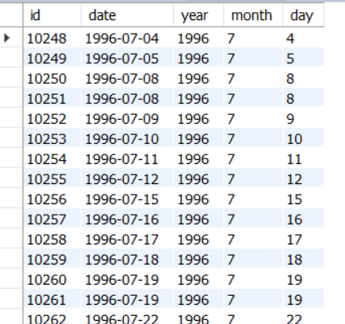
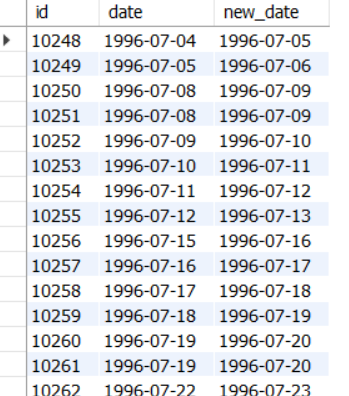
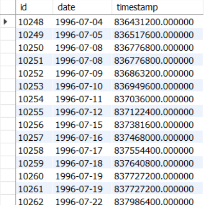
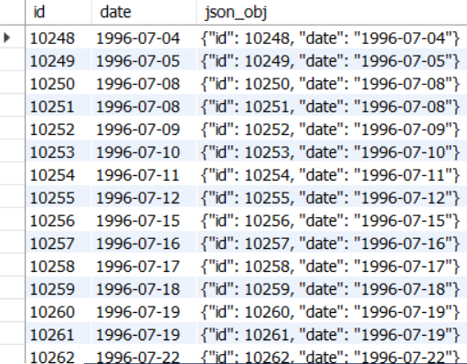

# goit-rdb-hw-07
## Date, time and SQL functions

Цей репозиторій містить практичні завдання з використання вбудованих функцій MySQL для роботи з датою і часом (`YEAR`, `MONTH`, `DAY`, `ADDDATE`, `UNIX_TIMESTAMP`), фільтрації за часовими інтервалами (`BETWEEN`), а також формування даних у форматі JSON за допомогою функції `JSON_OBJECT`.

---

## Структура репозиторію

* `goit-rdb-hw-07.sql` — повний скрипт з усіма SQL-запитами до завдань 1–5.
* `/screenshots/` — каталог зі скриншотами виконаних запитів та отриманих результатів:
  * `p1_get_date.png` — витяг року, місяця та дня з дати.
  * `p2_add_date.png` — додавання одного дня до дати.
  * `p3_ux_timestamp.png` — отримання значення UNIX timestamp у секундах.
  * `p4_date_between.png` — підрахунок кількості рядків у заданому діапазоні дат.
  * `p5_json_obj.png` — формування JSON-об'єкта.

---

## Опис виконаних завдань

### Завдання 1. Витяг частин дати (YEAR, MONTH, DAY)
Запит витягує рік, місяць і день з атрибута `date` таблиці `orders` та виводить їх у три окремі колонки поряд із `id` та оригінальною датою (всього 5 атрибутів).

```sql
SELECT 
    order_id AS id, 
    date, 
    YEAR(date) AS year, 
    MONTH(date) AS month, 
    DAY(date) AS day
FROM orders;
```


### Завдання 2. Додавання інтервалу до дати (ADDDATE)
Запит додає один день до атрибута date та виводить id, оригінальну дату й результуючу дату.

```sql
SELECT 
    order_id AS id, 
    date, 
    ADDDATE(date, INTERVAL 1 DAY) AS new_date
FROM orders;
```



### Завдання 3. Отримання UNIX Timestamp (UNIX_TIMESTAMP)
Запит конвертує значення атрибута date у кількість секунд з початку епохи Unix (1970-01-01 00:00:00 UTC).

```sql
SELECT 
    order_id AS id, 
    date, 
    UNIX_TIMESTAMP(date) AS timestamp
FROM orders;
```



### Завдання 4. Підрахунок кількості рядків у часовому діапазоні (BETWEEN)
Запит підраховує кількість замовлень із датою в межах від 1996-07-10 00:00:00 до 1996-10-08 00:00:00. Результат — 71 рядок.

```sql
SELECT COUNT(*) 
FROM orders
WHERE date BETWEEN '1996-07-10 00:00:00' AND '1996-10-08 00:00:00';
```


### Завдання 5. Створення JSON-об'єкта (JSON_OBJECT)
Запит генерує валідний JSON-об'єкт вигляду {"id": <id>, "date": "<date>"} для кожного рядка за допомогою функції JSON_OBJECT.

```sql
SELECT 
    order_id AS id, 
    date, 
    JSON_OBJECT('id', order_id, 'date', date) AS json_obj
FROM orders;
```


